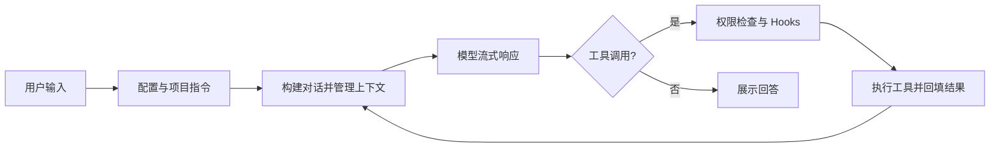

# YL1203Code

基于 Python 的 AI 编程助手，支持终端交互界面、单次命令执行和本机浏览器界面。模型可以读取项目、搜索代码、编辑文件和执行命令，并通过权限规则控制工具调用。

## 功能

- Textual 终端界面与流式回答。
- Anthropic、OpenAI Responses 和 OpenAI 兼容 Chat Completions 协议。
- 文件读取、搜索、编辑、命令执行与文件历史。
- 会话保存、长期记忆、上下文压缩和恢复。
- Skills、工具调用 Hooks 和 MCP 扩展。
- 子 Agent、团队消息与 Git worktree 工作区。

三个入口共用 Agent、权限、Skills、任务和 worktree 初始化。终端和浏览器支持交互审批，单次执行遇到需要确认的操作会拒绝。

## 安装

需要 Python 3.11 或更新版本、Git 和 uv。在仓库根目录执行命令：

```bash
git clone https://github.com/YL1203/YL1203Code.git
cd YL1203Code
uv sync --group dev
```

## 配置模型

可以使用向导创建本地配置，已有文件不会被覆盖：

```bash
uv run YL1203Code --init
uv run YL1203Code --doctor
```

也可以传入完整参数：

```bash
uv run YL1203Code --init --protocol openai-compat --base-url https://your-provider.example/v1 --model your-model-id
```

向导写入 `.YL1203Code/config.local.yaml`，只保存 API Key 的环境变量引用。`--doctor` 检查配置、开发工具、代理端口和沙箱依赖，不打印密钥，也不请求真实模型。

也可手动创建 `.YL1203Code/config.yaml`。配置文件必须包含至少一个 provider；仅设置 API Key 环境变量不足以启动程序。

```yaml
providers:
  - name: my-provider
    protocol: openai-compat
    base_url: https://your-provider.example/v1
    model: your-model-id
    api_key: ""

permission_mode: default
```

将 `base_url` 和 `model` 替换为服务商实际提供的地址与模型 ID。上面的地址是占位符。

| protocol | 接口 | API Key 环境变量 |
| --- | --- | --- |
| `anthropic` | Anthropic Messages | `ANTHROPIC_API_KEY` |
| `openai` | OpenAI Responses | `OPENAI_API_KEY` |
| `openai-compat` | OpenAI 兼容 Chat Completions | `OPENAI_API_KEY` |

`api_key` 留空时读取对应环境变量。例如在 PowerShell 中设置：

```powershell
$env:OPENAI_API_KEY = "你的 API Key"
```

macOS / Linux shell：

```bash
export OPENAI_API_KEY="你的 API Key"
```

配置按用户级 `~/.YL1203Code/config.yaml`、项目级 `.YL1203Code/config.yaml`、本地 `.YL1203Code/config.local.yaml` 的顺序加载。后层显式填写的标量值覆盖前层，包括 `false` 和 `default`；`worktree`、`sandbox`、`execution` 按显式字段合并。当前每一层文件都需要提供 `providers` 列表，后层列表会替换前层。

项目运行状态和配置目录 `.YL1203Code/` 已加入 Git 忽略规则。不要把真实密钥写进要提交的示例或文档。

## 使用

```bash
# 终端交互界面
uv run YL1203Code

# 执行单次请求
uv run YL1203Code -p "分析当前项目的入口和模块结构"

# 输出逐行 JSON 事件
uv run YL1203Code -p "解释当前项目" --output-format stream-json

# 本机浏览器界面
uv run YL1203Code --remote
```

浏览器访问 `http://127.0.0.1:18888`。服务默认只监听本机，并检查浏览器请求的来源。

### 权限模式

通过 `--mode` 或配置中的 `permission_mode` 选择模式：

| 模式 | 行为 |
| --- | --- |
| `default` | 通常允许项目内读取，写入和命令执行需要确认 |
| `acceptEdits` | 通常允许项目内文件修改，命令执行仍可能需要确认 |
| `plan` | 提供规划提示和计划文件写入例外；其他修改仍受权限检查约束 |
| `bypassPermissions` | 放宽模式默认限制，显式规则和危险命令检查仍会参与判断 |

`-p` 无法交互审批：遇到需要确认的操作会拒绝。需要无人值守修改文件时，应明确选择合适的模式，例如：

```bash
uv run YL1203Code --mode acceptEdits -p "修改项目内指定文件"
```

OS 命令沙箱提供 macOS Seatbelt、Linux bubblewrap，以及 Windows 上基于 Linux Docker 容器的后端。默认关闭；依赖不可用时保留普通权限检查，已挂载的后端在执行前失效时会停止命令，不会退回宿主机执行。

```yaml
sandbox:
  enabled: true
  auto_allow: false
  network_enabled: false

execution:
  max_iterations: 40
  max_total_tokens: 0
  timeout_seconds: 0
```

`execution` 限制每次 Agent 执行的轮次、模型累计输入输出 token 和时间。0 表示未设置该项限制；token 限制按模型返回的用量检查，不能截断已发送的单次请求。子 Agent 继承限制，并遵守父权限。超限会返回失败原因；CLI 返回非零退出码，后台任务不会被记为完成。

Windows 容器后端要求已启动的 Linux Docker 服务和已准备好的本地镜像，默认镜像名为 `python:3.11-slim`。程序不自动安装、启动 Docker 或拉取镜像。可以通过 `YL1203CODE_SANDBOX_IMAGE` 指定包含 `/bin/bash` 及项目工具链的自备镜像；依赖安装和镜像准备由使用者完成。

容器使用 Linux 命令，项目映射到 `/workspace`，临时文件放在容器 `/tmp`，不会继承宿主 API Key 环境变量。根文件系统只读，只挂载当前项目，默认断网并限制进程数、CPU 与内存。文件工具仍在宿主项目中执行，容器只约束 Bash；Hooks、MCP 及其他宿主工具不在容器内。宿主 Windows 绝对路径、`.exe`、Windows 虚拟环境以及外部路径不可直接在容器执行，项目依赖需存在于镜像中。Windows Git worktree 中的 `.git` 指向宿主路径，容器内的 Git 操作也需要单独适配。

对于尚不存在的受保护配置，bubblewrap 和 Docker 会把最近的已存在父目录设为只读，通常是整个 `.YL1203Code/`。这会限制 Bash 在该目录生成运行文件，宿主文件工具和程序自身仍按各自权限操作。

未启用容器时，命令工具使用当前平台默认 shell。`/sandbox` 查看实际后端和自动放行状态，`/sandbox on` 开启常规审批，`/sandbox off` 关闭。

### 项目、测试、变更与任务恢复

- `/project`：识别主要语言、构建文件和候选测试入口，最多扫描 2000 个文件或目录条目。
- `/resume [会话ID]`：在终端界面选择当前项目的历史对话，支持输入搜索、上下键翻页、Enter 恢复和 Esc 取消；也可指定完整会话 ID。恢复后继续保存到原会话，不重新执行历史工具。
- `/test [command]`：运行指定命令，未指定时使用识别到的第一个候选。
- `/test --fix [command]`：失败后进行有权限和预算限制的修复，并真实重跑，最多执行三次测试。可按 Esc 或使用浏览器取消按钮停止。
- `/diff [checkpoint]`：预览文件工具记录的当前会话变更，检查点编号从 1 开始。
- `/rewind <checkpoint> [option]`：1 恢复代码与对话，2 只恢复对话，3 只恢复代码；会删除该检查点之后由文件工具新建的文件。
- `/tasks`：查看当前和保存的后台任务；`/tasks resume <id>` 显式恢复中断、失败或取消的任务。
- `/review [focus]`：向 Agent 发起代码审查提示。

回退只覆盖当前进程会话中通过 WriteFile/EditFile 记录的文件；Bash、外部编辑器、MCP 修改及 Git 提交不在该文件历史中。文件历史不会在重启后自动恢复。需要完整仓库差异时使用 Git diff。继续工作即保留修改；退出 worktree 选择 keep 会保留目录与分支。

后台任务检查点保存在 `.YL1203Code/tasks/`，包含工具结果、原工具列表和权限规则。重启后运行中的任务显示为 interrupted，不自动执行。显式恢复时只允许当前与原规则共同许可的操作，原会话临时审批不会重新生效。缺失工具结果被标为结果未知，Agent 必须先检查当前文件；不会由恢复代码自动重放工具，但不保证模型或外部服务的 exactly-once 行为。

`-p` 会接收普通后台任务和团队消息，最多等待后台任务 180 秒，并在退出时取消仍在运行的任务。`stream-json` 的最终 result 只在全部处理与清理之后输出一次，包含 success 与 stop_reason。

### MCP 与项目指令

可在配置中增加 `mcp_servers`，例如连接自行提供的 stdio 服务：

```yaml
mcp_servers:
  - name: local-tools
    command: python
    args: ["/absolute/path/to/mcp_server.py"]
```

上述脚本需由使用者提供。`YL1203Code.md` 保存简短项目指令，`AGENTS.md` 保存开发约定；程序会在项目目录链中发现它们。内置 Agent 定义位于 `YL1203Code/agents/builtins/`，属于运行资源。

## 项目结构与流程

| 路径 | 职责 |
| --- | --- |
| `YL1203Code/__main__.py` | 三种运行入口 |
| `app.py`、`remote.py`、`web_content.py` | 终端与浏览器交互 |
| `agent.py`、`client.py`、`serialization.py` | Agent 循环、模型适配和消息转换 |
| `tools/`、`permissions/`、`sandbox/` | 工具执行、权限规则和系统隔离 |
| `context/`、`memory/`、`filehistory/` | 上下文、会话、记忆和文件历史 |
| `commands/`、`skills/`、`hooks/`、`mcp/` | 命令与扩展机制 |
| `agents/`、`teams/`、`worktree/` | 子任务、协作与工作区 |
| `tests/` | 自动化测试 |

除完整标明的路径外，上表代码路径均相对于 `YL1203Code/` 主包；`tests/` 位于仓库根目录。



## 开发与测试

```bash
uv run pytest
uv run pytest tests/test_permissions.py -q
uv build
```

请从仓库根目录运行。直接在主包目录启动 Python 测试可能使本地 `mcp/` 遮蔽第三方 MCP 包。部分测试涉及 Git、平台能力和用户目录，结果会受本机环境影响；新增测试应使用临时目录和 mock，避免真实模型调用。

开发规范见 [AGENTS.md](AGENTS.md)。
