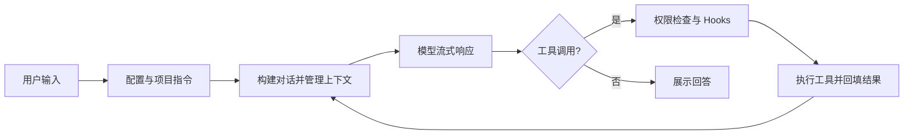

# YL1203Code

基于 Python 的 AI 编程助手，支持终端交互界面、单次命令执行和本机浏览器界面。模型可以读取项目、搜索代码、编辑文件和执行命令，并通过权限规则控制工具调用。

## 功能

- Textual 终端界面与流式回答。
- Anthropic、OpenAI Responses 和 OpenAI 兼容 Chat Completions 协议。
- 文件读取、搜索、编辑、命令执行与文件历史。
- 会话保存、长期记忆、上下文压缩和恢复。
- Skills、工具调用 Hooks 和 MCP 扩展。
- 子 Agent、团队消息与 Git worktree 工作区。

终端界面集成的功能最完整；单次执行和浏览器入口的交互能力有所不同。

## 安装

需要 Python 3.11 或更新版本、Git 和 uv。在仓库根目录执行命令：

```bash
git clone https://github.com/YL1203/YL1203Code.git
cd YL1203Code
uv sync --group dev
```

## 配置模型

先创建 `.YL1203Code/config.yaml`。配置文件必须包含至少一个 provider；仅设置 API Key 环境变量不足以启动程序。

```yaml
providers:
  - name: my-provider
    protocol: openai-compat
    base_url: https://your-provider.example/v1
    model: your-model-id
    api_key: ""

permission_mode: default
```

将 `base_url` 和 `model` 替换为服务商实际提供的地址与模型 ID。上面的地址是占位符。

| protocol | 接口 | API Key 环境变量 |
| --- | --- | --- |
| `anthropic` | Anthropic Messages | `ANTHROPIC_API_KEY` |
| `openai` | OpenAI Responses | `OPENAI_API_KEY` |
| `openai-compat` | OpenAI 兼容 Chat Completions | `OPENAI_API_KEY` |

`api_key` 留空时读取对应环境变量。例如在 PowerShell 中设置：

```powershell
$env:OPENAI_API_KEY = "你的 API Key"
```

macOS / Linux shell：

```bash
export OPENAI_API_KEY="你的 API Key"
```

配置按用户级 `~/.YL1203Code/config.yaml`、项目级 `.YL1203Code/config.yaml`、本地 `.YL1203Code/config.local.yaml` 的顺序加载。后层显式填写的标量值覆盖前层，包括 `false` 和 `default`；`worktree`、`sandbox` 按显式字段合并。当前每一层文件都需要提供 `providers` 列表，后层列表会替换前层。

项目运行状态和配置目录 `.YL1203Code/` 已加入 Git 忽略规则。不要把真实密钥写进要提交的示例或文档。

## 使用

```bash
# 终端交互界面
uv run YL1203Code

# 执行单次请求
uv run YL1203Code -p "分析当前项目的入口和模块结构"

# 输出逐行 JSON 事件
uv run YL1203Code -p "解释当前项目" --output-format stream-json

# 本机浏览器界面
uv run YL1203Code --remote
```

浏览器访问 `http://127.0.0.1:18888`。服务默认只监听本机，并检查浏览器请求的来源。

### 权限模式

通过 `--mode` 或配置中的 `permission_mode` 选择模式：

| 模式 | 行为 |
| --- | --- |
| `default` | 通常允许项目内读取，写入和命令执行需要确认 |
| `acceptEdits` | 通常允许项目内文件修改，命令执行仍可能需要确认 |
| `plan` | 提供规划提示和计划文件写入例外；其他修改仍受权限检查约束 |
| `bypassPermissions` | 放宽模式默认限制，显式规则和危险命令检查仍会参与判断 |

`-p` 无法交互审批：遇到需要确认的操作会拒绝。需要无人值守修改文件时，应明确选择合适的模式，例如：

```bash
uv run YL1203Code --mode acceptEdits -p "修改项目内指定文件"
```

OS 沙箱目前提供 macOS Seatbelt 和 Linux bubblewrap 实现，需要对应环境支持。Windows 尚无 OS 沙箱实现；仅开启配置不会获得内核隔离，也不会因此自动放行命令。命令工具使用当前平台默认 shell，命令语法需与系统匹配。

### MCP 与项目指令

可在配置中增加 `mcp_servers`，例如连接自行提供的 stdio 服务：

```yaml
mcp_servers:
  - name: local-tools
    command: python
    args: ["/absolute/path/to/mcp_server.py"]
```

上述脚本需由使用者提供。`YL1203Code.md` 保存简短项目指令，`AGENTS.md` 保存开发约定；程序会在项目目录链中发现它们。内置 Agent 定义位于 `YL1203Code/agents/builtins/`，属于运行资源。

## 项目结构与流程

| 路径 | 职责 |
| --- | --- |
| `YL1203Code/__main__.py` | 三种运行入口 |
| `app.py`、`remote.py`、`web_content.py` | 终端与浏览器交互 |
| `agent.py`、`client.py`、`serialization.py` | Agent 循环、模型适配和消息转换 |
| `tools/`、`permissions/`、`sandbox/` | 工具执行、权限规则和系统隔离 |
| `context/`、`memory/`、`filehistory/` | 上下文、会话、记忆和文件历史 |
| `commands/`、`skills/`、`hooks/`、`mcp/` | 命令与扩展机制 |
| `agents/`、`teams/`、`worktree/` | 子任务、协作与工作区 |
| `tests/` | 自动化测试 |

除完整标明的路径外，上表代码路径均相对于 `YL1203Code/` 主包；`tests/` 位于仓库根目录。



## 开发与测试

```bash
uv run pytest
uv run pytest tests/test_permissions.py -q
uv build
```

请从仓库根目录运行。直接在主包目录启动 Python 测试可能使本地 `mcp/` 遮蔽第三方 MCP 包。部分测试涉及 Git、平台能力和用户目录，结果会受本机环境影响；新增测试应使用临时目录和 mock，避免真实模型调用。

开发规范见 [AGENTS.md](AGENTS.md)。
